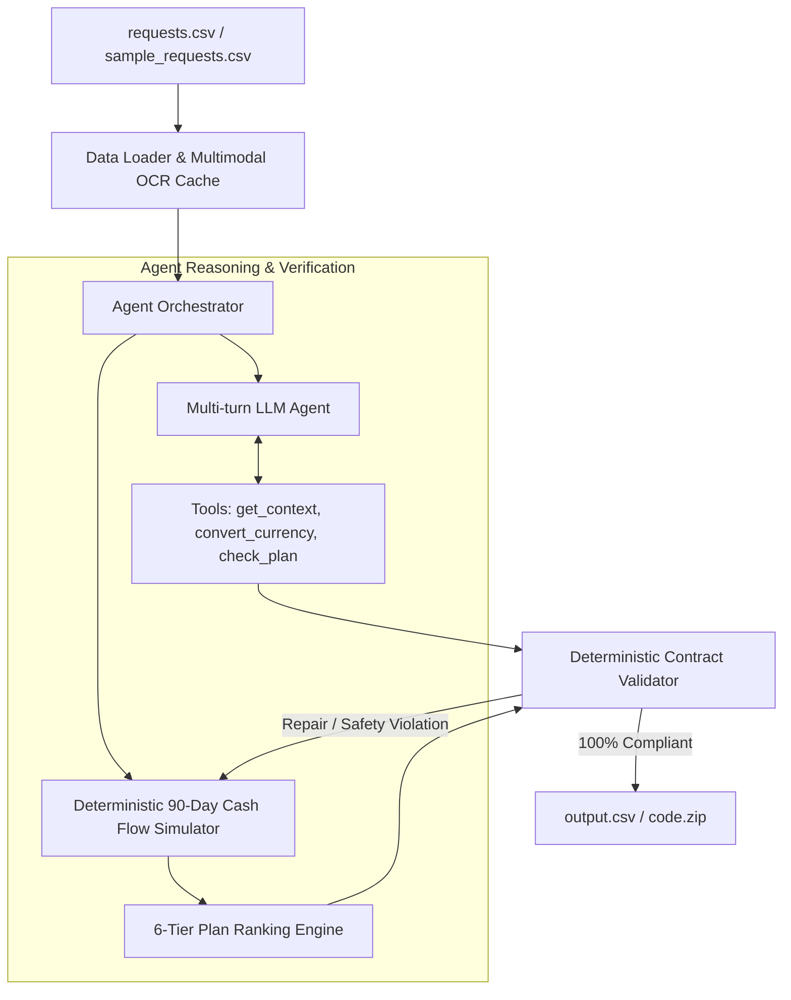

# Buy or Wait? — AI Financial Decision Agent

[](https://www.python.org/downloads/)
[](LICENSE)
[]()
[](https://www.hackerrank.com/contests/hackerrank-orchestrate-september26/challenges/buy-or-wait)

Autonomous AI financial decision agent built for the **HackerRank Orchestrate** Hackathon (September 2026). The system evaluates user affordability requests by synthesizing multi-account balances, recurring cash flows, pending debit reservations, multimodal image OCR, cross-currency exchange rates, and user preferences into safe, personalized payment recommendations.

---

## Architecture Overview

The system features a **hybrid agentic architecture**: an autonomous multi-turn LLM reasoning loop with native function calling, paired with a deterministic 90-day cash flow simulation engine.



### Core Subsystems

1. **Autonomous LLM Agent (`code/agent_loop.py`)**:
   - Multi-turn tool-calling agent using OpenAI/OpenRouter compatible function calling (`get_context`, `convert_currency`, `check_plan`).
   - Grounded in curated system prompts ([`code/prompts/system_prompt.md`](code/prompts/system_prompt.md)) and multi-currency few-shot examples ([`code/prompts/few_shot_examples.md`](code/prompts/few_shot_examples.md)).

2. **90-Day Cash Flow Simulator (`code/solver.py`)**:
   - Reconstructs liquid cash balances forward for 90 days from `request_date`.
   - Distinguishes recurring expenses from one-time transactions, reserves pending debits, counts confirmed salary on settlement dates, and ignores speculative/unrealized gains.
   - Computes conservative `amount_safe_to_pay` via binary-search over daily safety envelopes.

3. **Multimodal Evidence Integration (`code/tools.py`)**:
   - Directly resolves OCR amounts from `dataset/media/images/<image_id>.png` when financial events have blank amounts, ensuring unstated debits are never treated as zero.

4. **6-Tier Plan Ranking Engine (`code/solver.py`)**:
   Implements the exact prioritization hierarchy mandated by the competition specification:
   1. Complete full request by `desired_completion_date`.
   2. Require no spending changes.
   3. Minimize total amount paid (fees, interest).
   4. Start payment earlier.
   5. Use fewer payments.
   6. Lowest `payment_option_id` as the deterministic tie-breaker.

5. **Deterministic Contract Validator (`code/validator.py`)**:
   - 100% strict verification against the 8 required columns, enum constraints (`affordability_status`, `recommended_payment_method`), partial-payment 2-installment rules, date bounds, and flexible spending change constraints.

---

## Repository Layout

```text
.
├── README.md                         # Project documentation and architecture guide
├── AGENTS.md                         # Agent instructions, contract rules & session logging
├── problem_statement.md              # Full challenge specification
├── output.csv                        # Final generated predictions (251 lines, 250 requests)
├── code.zip                          # Clean distribution package for competition submission
├── log.txt                           # Full autonomous agent development audit trail
├── .env.example                      # Template for API keys and configuration
├── .gitignore                        # Git ignore excluding .env, .venv, and caches
│
├── code/                             # Complete runnable solution
│   ├── main.py                       # CLI entry point to run predictions
│   ├── agent_loop.py                 # Multi-turn LLM agent loop & solver orchestrator
│   ├── solver.py                     # 90-day simulation & 6-tier ranking engine
│   ├── tools.py                      # Tool calling definitions & image OCR data
│   ├── data_loader.py                # Dataset ingestion & entity relation mapper
│   ├── validator.py                  # Strict schema & financial logic validator
│   ├── usage_tracker.py              # Telemetry & token usage logger
│   ├── __init__.py
│   │
│   ├── prompts/                      # System instructions & few-shot prompts
│   │   ├── system_prompt.md          # Domain prompt with strict financial rules
│   │   └── few_shot_examples.md      # Calibrated multi-currency exemplar cases
│   │
│   └── evaluation/                   # Evaluation scripts and usage reports
│       ├── main.py                   # Self-evaluator against sample_requests.csv
│       └── usage_report.md           # Mandatory token usage and cost analysis report
│
└── dataset/                          # Input data & images (provided)
    ├── requests.csv                  # 250 test evaluation requests
    ├── sample_requests.csv           # 25 calibration samples with ground truth
    ├── financial_profiles.csv        # Balances, minimum balance, preferences
    ├── financial_events.csv          # Historical, pending, and scheduled events
    ├── request_payment_options.csv   # Seller/provider installment offers
    ├── exchange_rates.csv            # Dated currency conversion rates
    ├── messages.csv                  # Clarifying and contextual messages
    ├── images.csv                    # Metadata mapping images to events/requests
    ├── output.csv                    # Blank organizer template
    └── media/images/                 # PNG receipt and statement images
```

---

## Quick Start & Reproduction

### 1. Prerequisites

- Python 3.10+
- (Optional) OpenRouter or OpenAI API key for live LLM agent execution. The system runs fully offline/deterministically if no API key is provided.

### 2. Setup Environment

```bash
# Clone the repository
git clone https://github.com/RohitDSonawane/hackerrank-orchestrate-september26.git
cd hackerrank-orchestrate-september26

# Create and activate virtual environment
python -m venv .venv
# On Windows:
.venv\Scripts\activate
# On Linux/macOS:
source .venv/bin/activate

# (Optional) Configure environment variables for LLM agent
cp .env.example .env
# Add your OPENROUTER_API_KEY inside .env if testing live tool calling
```

### 3. Generate Predictions (`output.csv`)

Run the full pipeline on `dataset/requests.csv` (250 requests):

```bash
python code/main.py
```

This generates `output.csv` at the repository root and performs automatic validation.

### 4. Run Self-Evaluation & Calibration

Benchmark the solver against the ground-truth samples in `dataset/sample_requests.csv`:

```bash
python code/evaluation/main.py
```

---

## Deliverables & Submission Verification

This repository produces all 3 deliverables required by the HackerRank Orchestrate competition specification:

| Deliverable | Location | Description |
|---|---|---|
| **Predictions** | [`output.csv`](output.csv) | Exactly 251 lines (header + 250 predictions) matching all 8 required columns. |
| **Code Package** | [`code.zip`](code.zip) | Standalone package containing all runnable code, prompts, `README.md`, and `evaluation/usage_report.md`. Strictly excludes secrets (`.env`) and `.venv`. |
| **Audit Transcript** | [`log.txt`](log.txt) | Complete chronological transcript logging all development sessions and agent interactions per `AGENTS.md §5`. |

### Validation Guarantees

Every row generated in `output.csv` satisfies:
- `0 <= amount_safe_to_pay <= requested_amount`
- Exact 8-column header order without scientific notation or trailing commas.
- `payment_plan` is chronologically formatted (`YYYY-MM-DD:amount|...`) or `none`.
- Partial payments consist of exactly two payments summing to `requested_amount`.
- Installment schedules exactly match valid offers from `request_payment_options.csv`.
- Spending changes strictly target flexible, non-protected recurring expenses.

---

## Contest Submission Link

Submissions for this challenge are made at:
**[HackerRank Orchestrate: Buy or Wait? Submission Portal](https://www.hackerrank.com/contests/hackerrank-orchestrate-september26/challenges/buy-or-wait/submission)**

---

## License

This project is created as part of the HackerRank Orchestrate 2026 Hackathon under the MIT License.
